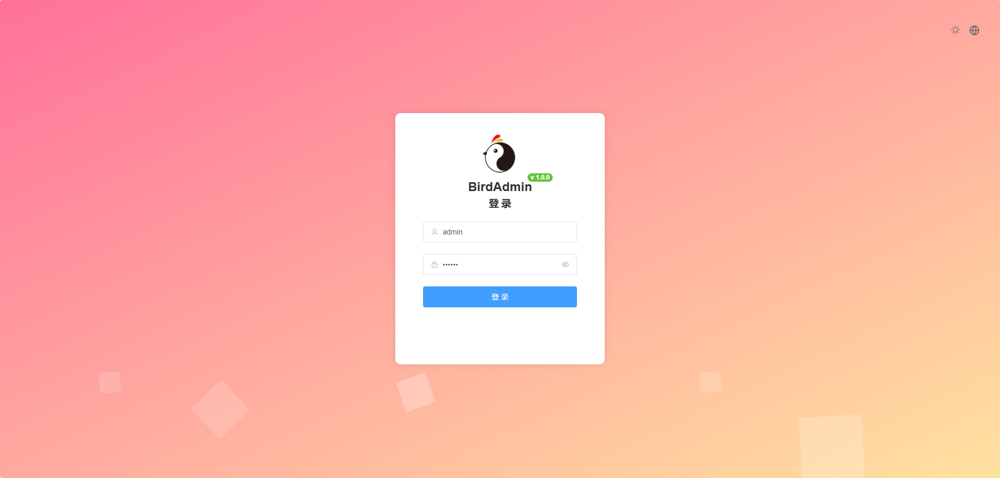
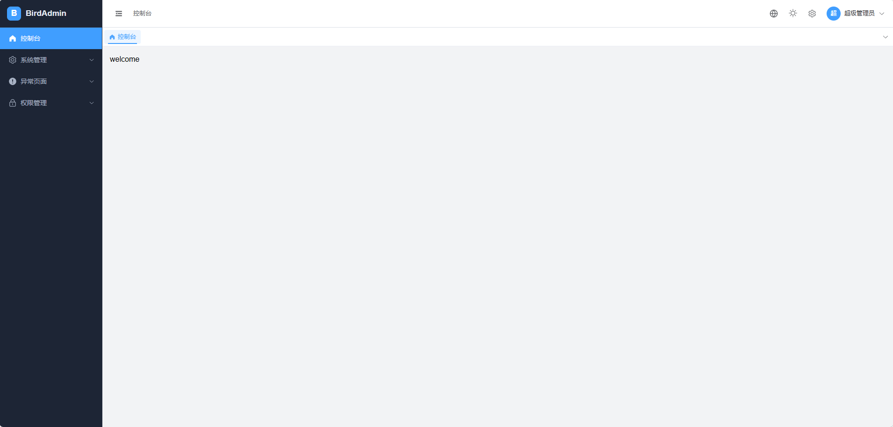
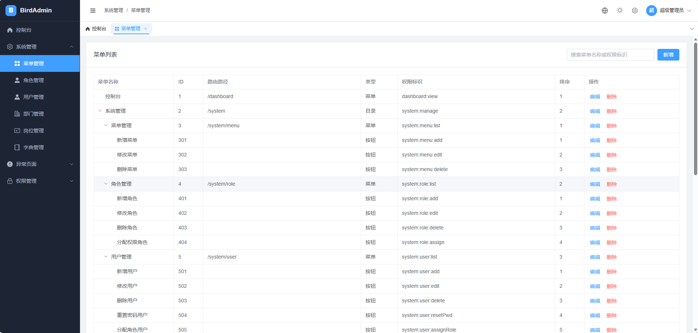
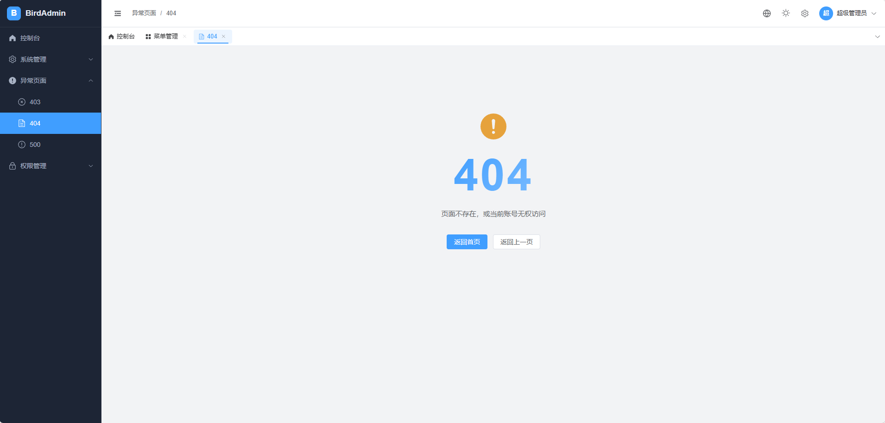

<br />
<div align="center">
    
    <h1 style="font-size: 36px;color: #2c3e50;font-weight: 600;margin: 0 0 6px 0;">BirdAdmin</h1>
    <p style="font-size: 17px;color: #6a8bad;margin-bottom: 10px;">使用流行技术栈快速创建商业级后台管理系统</p>
    <a href="https://gitee.com/web_akai/bird-admin" target="_blank">Gitee仓库</a>
</div>
<br />
<p align="center">
    <a href="https://nodejs.org/zh-cn/download" target="_blank">
        
    </a>
    <a href="https://pnpm.io/zh/installation" target="_blank">
        
    </a>
    <a href="https://v3.vuejs.org/" target="_blank">
        
    </a>
    <a href="https://element-plus.org/zh-CN/guide/changelog.html" target="_blank">
        
    </a>
    <a href="https://www.tslang.cn/" target="_blank">
        
    </a>
    <a href="https://vite.dev/" target="_blank">
        
    </a>
    <a href="https://pinia.vuejs.org/" target="_blank">
        
    </a>
    <a href="https://opensource.org/license/MIT" target="_blank">
        
    </a>
</p>

<br>
<div align="center">
    <strong>纯前端脚手架</strong> · 开箱即用的本地 Mock · 无需后端即可跑通完整 RBAC 流程
</div>
<br>

### 目录

- [介绍](#介绍)
- [主要特性](#主要特性)
- [项目预览](#项目预览)
- [安装使用](#安装使用)
- [开发指南](#开发指南)
- [多仓库同步](#多仓库同步)
- [接入真实后端](#接入真实后端)
- [实现状态与路线图](#实现状态与路线图)
- [常见问题与已知限制](#常见问题与已知限制)
- [联系我们](#联系我们)
- [特别鸣谢](#特别鸣谢)

### 介绍

🌈 BirdAdmin 是基于 `Vue 3.5 + Vite 7 + TypeScript 5.8 + Pinia 3 + Element Plus + UnoCSS` 的后台管理系统前端，支持按用户权限动态注册路由、按钮级鉴权、三种菜单布局、暗黑主题、多页签与中英切换，无需授权即可免费商用。

> 本仓库目前是**纯前端脚手架**，没有附带后端工程。所有 `/api/*` 接口由 `vite-plugin-fake-server` 在**开发环境**提供本地 Mock，生产构建不会注入任何假数据或演示账号。介绍中提到的 `Node.js``Next.js` `Spring Boot` 等后端属于规划能力，尚未实现；接真实后端的方法见 [接入真实后端](#接入真实后端)。

### 主要特性

**👍 流行且稳定的技术栈：**
`Vue 3.5`（`<script setup>` 组合式 API）、`Vite 7`、`TypeScript 5.8`、`Pinia 3`、`vue-router 4`、`Element Plus 2.10`、`UnoCSS`、`vue-i18n 11`、`@vueuse/core`、`Sass`。组件与 API 按需自动导入（`unplugin-vue-components` / `unplugin-auto-import`），本地 SVG 通过 `vite-svg-loader` 组件化、通过 UnoCSS `i-svg:图标名` 直接使用。

**🔀 前后端分离：**
仓库只含前端代码，通过统一的 `axios` 请求层与后端通信：接口前缀由 `VITE_API_BASE_URL` 统一配置，响应统一为 `{ code, data, message }`，认证走 `Authorization: Bearer <token>`。开发期可直接用本地 Mock 联调，也可配置 `VITE_API_PROXY_TARGET` 代理到真实后端，前端开发者无需掌握任何后端代码。（邀您：[和我们一起](https://qm.qq.com/cgi-bin/qm/qr?k=mtO25dYqAb6TvQabT3a32GpM-ymBgzyQ&jump_from=webapi&authKey=IdNeGCdGWY3agi7eUniBkHG7ME98B3hD2dBUFoLcBLtYrKEl1RfComEn+0sdrM+I) ）

**✨ 高颜值：**
提供 `左侧 / 顶部 / 混合` 三种菜单布局，支持经典蓝与极简白侧栏配色、明亮/暗黑/跟随系统三种主题、自定义主题色（含 `View Transition` 圆形扩散切换动画）、水印、组件尺寸、固定头部、Logo 与面包屑开关，全部设置可持久化并一键复制/恢复默认。

**🔐 权限验证：**
采用「用户 → 角色 → 菜单/按钮」的 RBAC 模型。登录后由 `/auth/routes` 下发当前用户可访问的菜单树，前端转换为 `RouteRecordRaw` 并用 `router.addRoute` 动态注册；按钮级权限同时提供 `v-permission` 指令、`<Auth>` 组件与 `hasPermission()` 函数三种用法。超级管理员权限码为 `*:*:*`。菜单树支持任意层级父子结构。**注意：** 可视化权限配置目前由 Mock 内存 CRUD 承载，尚未落库。

**📝 多页签与国际化：**
页签支持灵动 / 卡片 / Chrome 三种风格、滚轮横向滚动与溢出箭头、拖拽排序、中键关闭、右键菜单及右侧下拉操作（重新加载 / 关闭当前 / 关闭左、右、其他、全部）与可选持久化。中英双语采用「中文原文作为 i18n key」的方案，后端下发的菜单标题与 `document.title` 会自动翻译，未登记词条自动回退中文原文。

**💖 其他杂项：**
内置 403 / 404 / 500 异常页、动态页面标题、NProgress 进度条、控制台欢迎横幅（仅 dev）、ESLint 10 flat config、构建信息统计插件。更多特性等你探索...

### 项目预览

> 仓库暂未收录界面截图，可 `pnpm dev` 后访问 `http://localhost:9094/#/login` 直接体验。

|  |  |
|---------------------|---------------------|
|||
|||

| 模块 | 入口路径 | 说明 |
| --- | --- | --- |
| 登录 | `/login` | 账号密码登录、大小写锁定提示、暗色主题与语言切换 |
| 控制台 | `/dashboard` | 登录后的默认首页（`redirect` 指向首个可访问页面） |
| 系统管理 | `/system/menu` `/system/role` `/system/user` `/system/dept` `/system/post` `/system/dict` | 六类资源由同一套 schema 渲染，支持树形表格、分页筛选、CRUD、角色授权 / 用户分配角色 |
| 异常页面 | `/error/403` `/error/404` `/error/500` | 统一 `el-result` 风格；404 同时兼作路由兜底页面 |
| 权限管理 | `/permission/page` `/permission/button` | 切换演示账号观察菜单变化；演示指令 / 组件 / 函数三种按钮鉴权 |
| 其他 | `/empty` `/redirect/:path` | 全屏空白页示例、页签刷新中转路由 |

**演示账号（密码统一 `123456`，仅开发环境有效）：**

| 账号 | 角色 | 可见范围 |
| --- | --- | --- |
| `admin` | 超级管理员 | 全部菜单与按钮，权限码 `*:*:*` |
| `system` | 系统管理员 | 菜单 / 角色 / 用户 / 部门，无岗位与字典；演示按钮拥有 `add`、`edit` |
| `auditor` | 审计员 | 控制台 + 用户列表（只读）；演示按钮仅 `add` |
| `guest` | 访客 | 控制台 + 异常页面 + 权限管理页，无演示按钮权限 |

### 安装使用

**环境要求：** `Node.js ^20.19.0 || >=22.12.0`（见 `package.json` 的 `engines`，Vite 7 不再支持 Node 16/18）、`pnpm 10.x`。

```bash
# 克隆项目
git clone https://gitee.com/web_akai/bird-admin.git

# 进入项目
cd bird-admin

# 安装 pnpm（已安装可跳过）
npm i -g pnpm

# 安装依赖
pnpm install

# 启动开发服务器（默认 http://localhost:9094）
pnpm run dev

# 类型检查 / 代码检查
pnpm run typecheck
pnpm run lint

# 打包发布（先 vue-tsc --noEmit，再 vite build，产物在 dist/）
pnpm run build

# 本地预览生产包
pnpm run preview
```

**环境变量**（`.env` 通用，`.env.development` / `.env.production` 按模式覆盖）：

| 变量 | 开发环境 | 生产环境 | 说明 |
| --- | --- | --- | --- |
| `VITE_BASE_PATH` | `/` | `/` | 打包基础路径 |
| `VITE_PORT` | `9094` | 不适用（通用值仍为 `9094`） | dev server 端口；被占用时会顺延（`strictPort: false`） |
| `VITE_API_BASE_URL` | `/api` | `/api` | 请求 `baseURL`。**接口 url 相对该地址，不要再自带 `/api` 前缀**；生产改为真实后端地址 |
| `VITE_API_PROXY_TARGET` | 空 | 空 | 非空时启用 `/api` 开发代理，且会 `rewrite` 去掉 `/api` 前缀；留空则走本地 Mock |
| `VITE_DROP_CONSOLE` | `false` | `true` | 生产构建移除 `console` / `debugger`（配置在 `vite.config.ts` 顶层 `esbuild.drop`） |

#### 💯 学习交流加 QQ 群

> 请加以下群号，感谢老哥们支持！

群号：[829514092](https://qm.qq.com/cgi-bin/qm/qr?k=mtO25dYqAb6TvQabT3a32GpM-ymBgzyQ&jump_from=webapi&authKey=IdNeGCdGWY3agi7eUniBkHG7ME98B3hD2dBUFoLcBLtYrKEl1RfComEn+0sdrM+I)

<a target="_blank" href="https://qm.qq.com/cgi-bin/qm/qr?k=mtO25dYqAb6TvQabT3a32GpM-ymBgzyQ&jump_from=webapi&authKey=IdNeGCdGWY3agi7eUniBkHG7ME98B3hD2dBUFoLcBLtYrKEl1RfComEn+0sdrM+I"></a>

### 开发指南

#### 目录结构

```text
bird-admin/
├── build/vite/              # Vite 配置拆分：resolve / plugin / server / build
│   └── vite/plugin/         # 自动导入、UnoCSS、Mock、构建信息插件
├── mock/rbac/               # 仅 dev 生效的 RBAC 接口与内存种子数据
│   ├── data.ts              # 菜单 / 角色 / 用户 / 部门 / 岗位 / 字典种子
│   ├── helper.ts            # globalThis 内存 DB、鉴权、树构造、分页、种子签名
│   └── auth|menu|role|user|dept|post|dict.ts
├── src/
│   ├── api/                 # 类型化接口客户端（auth.ts + rbac/*）
│   ├── assets/              # 图标、SVG、登录背景、样式（reset/layout/theme-transition）
│   ├── components/          # Auth、CommonWrapper、DarkModeSwitch、LangSelect
│   ├── config/              # 默认外观设置
│   ├── directive/           # v-permission 指令
│   ├── enums/               # 布局 / 主题 / 页签风格 / 语言枚举
│   ├── layout/              # 三种布局组装 + 侧栏 / 顶栏 / 页签 / 设置抽屉
│   ├── locales/             # vue-i18n 语言包与菜单标题翻译 composable
│   ├── plugins/             # i18n、Element Plus 图标、权限指令注册
│   ├── router/              # 守卫、静态路由、菜单树工具函数
│   ├── store/modules/       # app / settings / user / permission / tags-view
│   ├── utils/
│   │   ├── request/         # axios 封装：拦截器、token、取消、loading、离线队列
│   │   ├── permission.ts    # 按钮权限判断
│   │   ├── theme.ts         # 主题应用与 View Transition 切换
│   │   └── pageTitle.ts     # 动态页面标题
│   └── views/               # login / dashboard / system / permission / error
├── .env*                    # 环境变量
├── uno.config.ts            # UnoCSS 预设、快捷类与本地 SVG 图标集合
└── vite.config.ts           # Vite 入口配置
```

路径别名：`@` → `src/`，`@styles` → `src/assets/styles/`（见 `build/vite/resolve.ts`）。

#### 请求层

统一从 `@/utils/request` 导入 `request` 单例，`baseURL` 取自 `VITE_API_BASE_URL`（默认 `/api`），超时 15s，自动附加 `Authorization: Bearer <token>`。

```ts
import { request } from "@/utils/request";
import type { BaseResponse } from "@/utils/request/types";

// url 不要写 /api 前缀
export function getUserListApi(params: PageQuery) {
  return request.get<BaseResponse<PageResult<SysUser>>>("/user/list", params, {
    requestOptions: { showLoading: false, retryCount: 2 },
  });
}
```

响应统一为 `{ code, data, message }`，成功码 `200` 或 `0`；其他业务码会弹出服务端文案并 `reject` 一个携带 `code` / `data` 的 `Error`。`blob` / `arraybuffer` 响应返回完整 `AxiosResponse`，供下载逻辑读取响应头。

| `requestOptions` | 默认值 | 作用 |
| --- | --- | --- |
| `showLoading` / `loadingText` | `true` / `加载中...` | 全屏 loading，内部引用计数避免并发闪烁 |
| `cancelRepeatRequest` | `true` | 按 method+url+params+data 取消重复请求（`FormData` 不参与去重） |
| `autoRefreshToken` | `true` | 401 自动刷新 token 并重放；临期（5 分钟内）后台静默续期 |
| `handleErrorStatus` / `showErrorMessage` | `true` / `true` | HTTP 状态码与业务码统一处理 / 错误提示 |
| `queueWhenOffline` | `true` | 离线时入队，网络恢复后用原 axios 实例重放 |
| `retryCount` / `retryDelay` | `0` / `1000` | 网络错误或 5xx 自动重试 |
| `cacheBust` / `skipBusinessCheck` | `false` | GET 追加时间戳 / 跳过业务码判定 |
| `fileName` / `timeout` / `errorHandler` | — | 下载文件名 / 单次超时 / 自定义错误处理 |

另提供 `upload()`、`uploadMultiple()`、`download()`（支持 `Content-Disposition` 的 `filename*=UTF-8''...`）、`exportExcel()`、`cancelAllRequests()`、`clearOfflineQueue()`。

#### 权限体系与新增页面

菜单类型：`M` 目录 / `C` 页面 / `F` 按钮；权限标识形如 `system:user:add`，超管为 `*:*:*`。登录返回的 `permissions` 存入 `userStore`，路由守卫在刷新页面后先 `GET /auth/getUserInfo` 恢复资料，再 `GET /auth/routes` 生成动态路由并 `addRoute`。

按钮权限三种写法（语义一致，数组表示满足其一即可）：

```vue
<template>
  <el-button v-permission="'system:user:add'">新增</el-button>
  <Auth :value="['system:user:edit', 'system:user:add']">受保护内容</Auth>
</template>
<script setup lang="ts">
import { hasPermission } from "@/utils/permission";
const canDelete = computed(() => hasPermission("system:user:delete"));
</script>
```

新增一个受权限控制的页面需要 4 步：

1. 在 `src/views/` 新建 `.vue` 页面；
2. 在 `src/store/modules/permission.ts` 的 `componentMap` 登记 `组件标识 → 动态 import`；
3. 在 `mock/rbac/data.ts` 的 `menuSeed` 增加菜单节点（`component` 填第 2 步的标识），并给相应角色授权；接入真实后端后改由后端菜单表下发；
4. 在 `src/locales/modules/{zh-cn,en}.ts` 的 `menus` 下补译文（可不补，未命中会回退中文原文）。

> Mock 的 DB 带种子签名：修改任一 seed 会自动重建内存库，dev server 不重启也能看到新菜单。

#### Mock 接口清单

以下路径均相对 `VITE_API_BASE_URL`（`/api`）。除 `/login` 与 `/auth/refresh-token` 外，均需携带 `Authorization: Bearer <token>`。

| 分组 | 接口 |
| --- | --- |
| 认证 | `POST /login`、`POST /auth/refresh-token`、`GET /auth/getUserInfo`、`GET /auth/routes`、`POST /auth/logout` |
| 菜单 | `GET /menu/tree`、`GET /menu/list`（树形，关键字过滤保留祖先链）、`GET /menu/:id`、`POST /menu`、`PUT /menu/:id`、`DELETE /menu/:id` |
| 角色 | `GET /role/list`、`GET /role/options`、`GET /role/:id`、`POST /role`、`PUT /role/:id`、`DELETE /role/:id`、`PUT /role/:id/permissions`、`PUT /role/:id/status` |
| 用户 | `GET /user/list`、`GET /user/:id`、`POST /user`、`PUT /user/:id`、`DELETE /user/:id`、`PUT /user/:id/roles`、`PUT /user/:id/password`、`PUT /user/:id/status` |
| 部门 | `GET /dept/tree`、`GET /dept/list`、`GET /dept/:id`、`POST /dept`、`PUT /dept/:id`、`DELETE /dept/:id` |
| 岗位 | `GET /post/list`、`GET /post/options`、`GET /post/:id`、`POST /post`、`PUT /post/:id`、`DELETE /post/:id` |
| 字典类型 | `GET /dict/type/list`、`GET /dict/type/:id`、`POST /dict/type`、`PUT /dict/type/:id`、`DELETE /dict/type/:id` |
| 字典数据 | `GET /dict/data/list`、`GET /dict/data/options`、`GET /dict/data/:id`、`POST /dict/data`、`PUT /dict/data/:id`、`DELETE /dict/data/:id` |

分页参数 `pageNum` / `pageSize`，返回 `{ list, total, pageNum, pageSize }`。业务码：`401` 未登录 / 失效、`403` 无权限、`404` 资源不存在、`10002` 密码错误、`10003` 账号停用、`10005` 参数错误、`10006` 数据冲突。

#### 外观设置与国际化

- 设置状态在 `store/modules/settings.ts`，通过 `useStorage` 持久化到 `localStorage`（`bird-setting-*`），页签数据用 `bird-tags-views` / `bird-tags-cache`；入口是顶栏的「项目设置」抽屉，支持复制当前配置与恢复默认。
- 主题由 `App.vue` 的 `watch` 同步到 `html.dark` / `body[data-layout]` / `html[data-sidebar-color]`，主题色由 `utils/theme.ts` 派生 Element Plus 的 `light-{3,5,7,8,9}` / `dark-2` CSS 变量。
- i18n 语言包位于 `src/locales/modules/`，命名空间：`route`、`menus`、`error`、`permission`、`login`、`navbar`、`tagsView`、`sizeSelect`、`langSelect`、`settings`。后端菜单标题走 `useMenuTitle()` 的 `menus.<中文原文>` key，页面标题由 `router.afterEach` 调用 `setPageTitle()` 生成「页面标题 - 系统名」。
- 本地 SVG 放入 `src/assets/svg/` 后可用 `i-svg:文件名` 引用（`uno.config.ts` 自动生成 safelist）；带原色的图标放 `preserve-color/` 子目录。

### 多仓库同步

项目同时维护 Gitee 与 GitHub 两个仓库，`scripts/sync-repos.mjs` 负责一次推送到两边：逐个推送、失败不中断，最后输出逐项结果。

| 仓库 | 地址 | 脚本识别的远端名 |
| --- | --- | --- |
| Gitee | `https://gitee.com/web_akai/bird-admin.git` | `origin` |
| GitHub | `https://github.com/birdadminvue3/bird-admin.git` | `github` |

```bash
pnpm sync                       # 推送当前分支到两个仓库
pnpm sync --all-branches        # 推送全部本地分支（如 develop + master）
pnpm sync -b develop -b master  # 只推送指定分支
pnpm sync --commit -m "feat: x" # 自动提交工作区改动后推送
pnpm sync:dry                   # 只打印将要执行的命令，不实际推送
```

- 首次运行会自动补齐缺失的远端：已有远端按 URL 匹配复用（例如 Gitee 的 `origin`），不会重复添加。
- 默认要求工作区干净，有未提交改动时会中止并列出文件，避免把半成品推上去；确需推送已提交内容可用 `--allow-dirty`。
- 任一仓库失败不影响另一个继续推送；结束时会给出失败原因提示（认证失败 / 远端有新提交 / 分支保护等），失败时退出码为 `1`，可直接接入 CI。
- 认证默认走系统 Git 凭据管理器（Windows Credential Manager / macOS Keychain）。CI 环境可设置 `GITEE_TOKEN`、`GITHUB_TOKEN`（或 `GH_TOKEN`），脚本只在本次 push 命令中使用，不写入 `.git/config`，日志中也会自动脱敏。

> 提示：`.env*` 与 `.workbuddy/memory/` 已被 Git 跟踪（当前内容不含密钥），新增配置前请确认没有把账号、令牌提交进仓库。

### 接入真实后端

1. 在 `.env.production` 设置 `VITE_API_BASE_URL`（如 `https://api.example.com/api`）；若只需本地代理，设置 `VITE_API_PROXY_TARGET`，注意 `build/vite/server.ts` 会把 `/api` 前缀 `rewrite` 掉，后端路由不要重复带 `/api`。
2. 实现上表接口，统一返回 `{ code, data, message }`，成功码为 `200` 或 `0`；错误时 HTTP 保持 200 并在 `message` 中给出原因。
3. 登录接口返回 `{ accessToken, refreshToken, expiresIn, ...用户资料 }`（`expiresIn` 单位秒）；`GET /auth/getUserInfo` 返回 `UserProfile`（含 `roles`、`permissions`）；`GET /auth/routes` 返回 `MenuRoute[]`，其中 `component` 必须是 `componentMap` 已登记的标识。
4. 401 时请求层会用 `POST /auth/refresh-token` 刷新并重放原请求；刷新失败会清空 token 并跳转 `/#/login`。
5. 无需删除 `mock/`：`configMockPlugin(isBuild)` 仅在 `vite build` 时返回 `null`，生产包不含 Mock 代码与演示账号。

### 实现状态与路线图

**已实现（可直接运行）**

- 工程与构建：Vite 7 + TypeScript + ESLint 10，`pnpm build` 先类型检查再打包，产物按 `static/js|css|imgs` 分目录、不生成 sourcemap、生产移除 `console`；dev 端构建信息插件输出文件数与体积。
- 认证与路由守卫：登录、token 持久化 / 过期判断、并发刷新订阅、401 重放、离线队列、重复请求取消、hash 路由兜底 404。
- RBAC：菜单 / 角色 / 用户 / 部门 / 岗位 / 字典六类资源的 Mock CRUD，角色授权、用户分配角色、重置密码、状态切换，按用户权限下发动态路由与按钮权限。
- 界面：三种布局、暗黑主题与主题色、View Transition 切换特效、三种页签风格与完整页签操作、设置抽屉、水印、中英双语、动态页面标题、403/404/500、权限演示页。
- 验证情况：`pnpm lint` 无错误、`pnpm build` 成功；dev 环境已对登录、刷新、22 项只读 / 权限断言与 33 项 CRUD / 授权断言做过接口级验证；生产包已确认无 Mock 凭据与 console 横幅。

**尚未实现 / 规划中**

- `Node.js``Next.js` `Spring Boot` 或其他真实后端、数据库持久化与可视化权限配置（当前权限数据仅在 dev 内存中）。
- 在线演示站、验证码 / 记住我 / 忘记密码（登录页相关代码已注释保留）、图表大屏（ECharts）、富文本、文件上传等业务模块。
- 单元测试 / E2E、CI 流水线，以及仓库根目录的 `LICENSE` 文件（见 [版权信息](#版权信息)）。

### 常见问题与已知限制

| 问题 | 说明 |
| --- | --- |
| Mock 数据为什么重启后还原？ | 数据挂在 `globalThis.__BIRD_ADMIN_RBAC_DB_V1__` 内存单例，仅在 dev 进程内共享；种子变化会按签名自动重建，重启 dev 恢复种子数据。由于 `vite-plugin-fake-server` 对每个 mock 文件单独 bundle，跨文件共享状态**必须**挂 `globalThis`，普通模块级变量会被复制成多份。 |
| 接口 404 / 出现 `/api/api/...`？ | `VITE_API_BASE_URL` 已包含 `/api`，`src/api/**` 里的 url 不要再带前缀。 |
| 登录后报 `Maximum call stack size exceeded`？ | 使用 hash 路由时，静态兜底路由必须渲染 404 组件；若 `redirect` 到动态注入的 `/dashboard`，会在进入守卫前自递归。另不要在 `next()` 里回传整个 `to` 对象，只传 `path/query/hash`。 |
| 想换 dev 端口？ | 用 `pnpm exec vite --port 9095`；`pnpm dev -- --port X` 经 pnpm 转发不会生效。端口被占用时 Vite 会自动顺延。 |
| token 安全 | 目前存于 `localStorage`（`AUTH_TOKEN` / `REFRESH_TOKEN` / `TOKEN_EXPIRES_AT`），存在 XSS 风险；生产环境建议改为 `httpOnly` Cookie 并配合 CSRF 防护。 |
| 主题切换没有动画？ | 圆形扩散依赖 `document.startViewTransition`，不支持的浏览器或开启「减少动态效果」时自动降级为直接切换。 |
| 语言切换后菜单没翻译？ | 检查 `src/locales/modules/*.ts` 的 `menus` 下是否有对应中文原文词条；未登记时会回退显示中文。 |

### 联系我们

- 演示站：**暂无在线演示站**，请 `pnpm dev` 本地运行体验；演示账号见 [项目预览](#项目预览)
- [Gitee 仓库](https://gitee.com/web_akai/bird-admin)
- [官方邮箱 web_bird@qq.com](mailto:web_bird@qq.com)

### 特别鸣谢

💕 感谢巨人提供肩膀，排名不分先后。以下为本项目**实际使用**的技术与工具（未使用的库不再列出）：

- 框架与构建：[Vue](https://github.com/vuejs/core)、[vue-router](https://github.com/vuejs/vue-router)、[Pinia](https://github.com/vuejs/pinia)、[Vite](https://github.com/vitejs/vite)、[TypeScript](https://github.com/microsoft/TypeScript)、[ESLint](https://github.com/eslint/eslint)
- UI 与样式：[Element Plus](https://github.com/element-plus/element-plus)、[UnoCSS](https://github.com/unocss/unocss)、[Sass](https://github.com/sass/sass)、[nprogress](https://github.com/rstacruz/nprogress)
- 数据与工具：[Axios](https://github.com/axios/axios)、[vue-i18n](https://github.com/intlify/vue-i18n)、[VueUse](https://github.com/vueuse/vueuse)、[dayjs](https://github.com/iamkun/dayjs)、[vite-plugin-fake-server](https://github.com/condorheroblog/vite-plugin-fake-server)、[unplugin-auto-import](https://github.com/unplugin/unplugin-auto-import)、[unplugin-vue-components](https://github.com/unplugin/unplugin-vue-components)、[vite-svg-loader](https://github.com/jpkleemans/vite-svg-loader)
- 参考项目：[vue-pure-admin](https://github.com/pure-admin/vue-pure-admin)（布局与页签设计）、[cool-admin-vue](https://gitee.com/cool-team/cool-admin-vue)（国际化与主题切换特效）
- [VSCode](https://code.visualstudio.com/) 提供开发工具支持。
- [WorkBuddy](https://www.workbuddy.cn/) 提供AI支持。

### 版权信息

⚖️ BirdAdmin 遵循 [MIT](./LICENSE) 开源协议发布，提供无需授权的免费使用。\
本项目包含的第三方源码和二进制文件之版权信息另行标注。\
Copyright (c) 2026 前端很开门。

### 支持项目

💕 无需捐赠，如果觉得项目不错，或者已经在使用了，希望你可以去 [Gitee](https://gitee.com/web_akai/bird-admin.git) 帮我点个 ⭐ Star，这将是对我极大的鼓励与支持。

### 免责声明

🚫 禁止使用本项目从事一切违法犯罪活动。作者不承担任何法律责任，特此声明